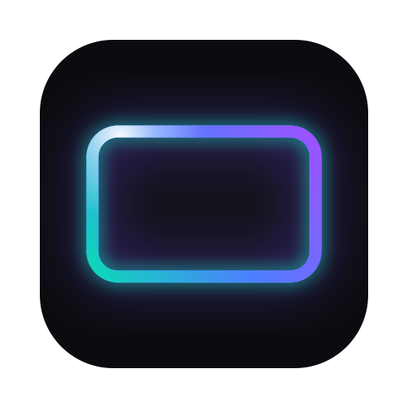
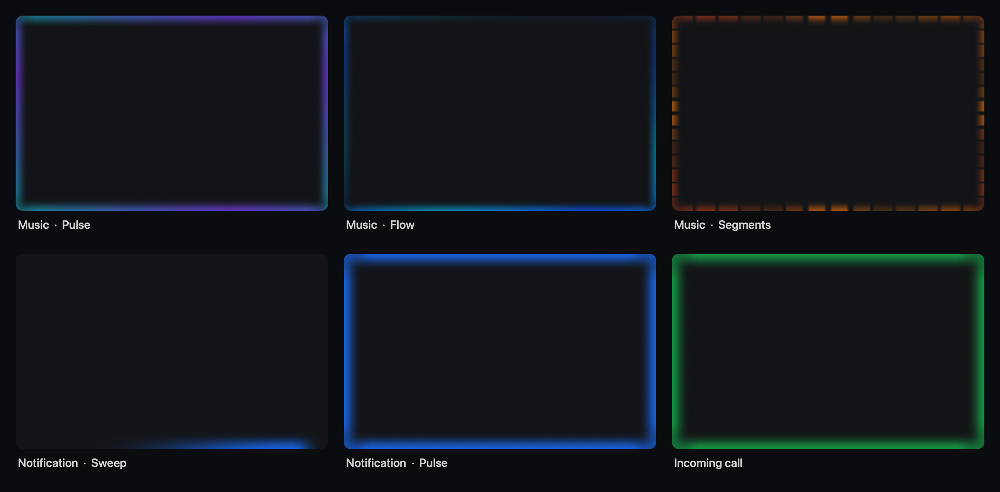

<p align="center">
  
</p>

<h1 align="center">Brink</h1>

<p align="center">
  Soft light along the edges of your Mac's screen.<br>
  It follows your music and glows for notifications and calls.
</p>

<p align="center">
  
  
  <a href="LICENSE"></a>
</p>

<p align="center">
  
</p>
<p align="center"><sub>Rendered by Brink's own drawing code on a stand-in desktop. The glow sits on the very edge of your real screen, over any app.</sub></p>

---

Brink lives in the menu bar and stays out of the way. A thin, even strip of light runs along the screen edges. It never covers the middle of the screen, and your mouse clicks pass straight through it. When nothing is happening it switches off completely.

## Features

- **Music:** reacts to whatever your Mac is playing (Spotify, Apple Music, YouTube, anything). It follows the beat: each kick lights up, and the gaps between beats fall back. Quiet songs react as strongly as loud ones.
  - **Pulse:** the whole edge breathes with the beat
  - **Flow:** a slow band of colour drifts round the screen
  - **Segments:** the edge is split into small lights that follow the pitch
- **Notifications:** a glow when a banner appears, in the app's own colour or one you pick.
- **Calls:** FaceTime and phone-call banners glow until the call ends.
  - **Pulse**, **Sweep** (a streak runs round the edges) or **Blink**, for both
- **Yours to edit:** menu bar icon ▸ **Customise…** for colours (four presets or up to three of your own), animation types, thickness and brightness. Changes show live, and **Try it** previews each effect without needing music or a real notification.
- **Private:** no network access, no accounts. Audio is turned into a few loudness numbers and thrown away; nothing is recorded or saved.

## What works, and how well

| Feature | Status |
|---|---|
| Music reaction (Pulse, Flow, Segments) | Tried on the author's Mac with real music |
| Edge glow, colours, settings window, Try it | Built and unit-tested |
| Notification and call glow | **Experimental.** macOS has no official way to read other apps' notifications, so Brink watches the Notification Center banner through the Accessibility API. It may need adjusting on some macOS versions, and has **not yet been confirmed on real notifications or calls** |

## Install

Requires macOS 13 or later.

1. Build it ([below](#build-from-source)) or download a release when one is published.
2. Open **Brink**. A small rays icon appears in the menu bar.
3. Click it, then **Allow Screen Recording** (for music) and **Allow Accessibility** (for notifications and calls). Switch Brink on in the System Settings page that opens.
4. Choose **Restart Brink** in the menu. macOS only applies a new permission to a fresh launch.

Why Screen Recording? It is the permission macOS uses for capturing system audio. Brink asks only for sound, never for the picture.

The app is ad-hoc signed, so macOS may ask you to confirm on first launch (**System Settings ▸ Privacy & Security ▸ Open Anyway**). Each time you rebuild it from source, macOS treats it as a new app and the two permissions have to be granted again; a Developer ID signature avoids that.

## Trigger it yourself

Other tools can light the edges through links:

```sh
open "brink://notify?app=Slack"   # a notification glow
open "brink://call"                # a call glow, until cleared
open "brink://clear"               # end the call glow
open "brink://music-demo"          # 10 seconds of made-up beat
```

## Troubleshooting

Brink writes a small log to `~/Library/Logs/Brink.log` (menu ▸ **Show log in Finder**). It says which permissions are allowed, whether audio capture started, and prints the exact error if it failed.

- **Nothing happens with music:** check Screen Recording is on, choose **Restart Brink**, and make sure something is actually playing. The log shows lines like `music: audio capture running`.
- **The permission is on but still says not allowed:** remove Brink from the list with the − button, add it again with the menu's **Allow…** item, and restart it.

## Build from source

```sh
git clone https://github.com/Jotharsh/Brink.git
cd Brink
swift build           # debug
swift test            # unit tests
./scripts/build.sh    # dist/Brink.app
./scripts/make_dmg.sh # dist/Brink.dmg
```

Handy extras: `Brink --hero out.png` draws the preview sheet above, `Brink --preview folder` writes sample frames, `Brink --bench` times the renderer, and `swift scripts/make_icon.swift` redraws the icon.

## How it works

```
Sources/BrinkCore/   no windows: spectrum analysis (FFT), beat tracking, colours, the glow renderer
Sources/Brink/       the app: overlay windows, audio capture, notification watcher, settings window
```

- Audio comes from ScreenCaptureKit's system-audio capture, is turned into 32 loudness bands with an FFT, and a beat tracker compares each moment with the last couple of seconds so every kick reaches full brightness.
- Each edge is one even strip of light, built from a colour gradient masked by a fall-off, so animations only change brightness and colour, never the shape.
- The glow is drawn small and stretched by the GPU: a frame costs about 1 to 3 ms, and the overlay sleeps completely when idle.

## License

[MIT](LICENSE).
